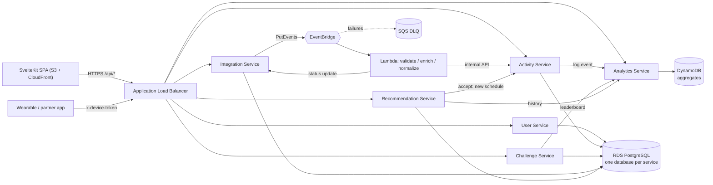

# HabitLoop: multi-tenant habit and challenge platform

Track habits, join public or private challenges, connect wearables, and get timing recommendations.
Built as six Node.js/TypeScript microservices, a SvelteKit (Svelte 5 runes) frontend with Lit web components,
and an event-driven integration pipeline (EventBridge + Lambda) designed for AWS (ECS, RDS, DynamoDB, S3).

## 1. Architecture



| Service | Responsibility | Store |
|---|---|---|
| **User** (`/api/users`) | Sign-up/login, tenants, JWT carrying `tenantId` | PostgreSQL `users` |
| **Activity** (`/api/activities`) | Habits, schedule rules, activity logs (done / missed / completed) | PostgreSQL `activities` |
| **Challenge** (`/api/challenges`) | Public/private challenges, invites, participation, leaderboard | PostgreSQL `challenges` |
| **Integration** (`/api/integrations`) | Device connections, event ingestion (idempotent), publishes to EventBridge | PostgreSQL `integrations` |
| **Analytics** (`/api/analytics`) | Streaks, completion trends, hourly stats, challenge progress | DynamoDB |
| **Recommendation** (`/api/recommendations`) | Best-time and frequency suggestions, accept/dismiss | PostgreSQL `recommendations` |
| **Lambda** (`lambdas/event-processor`) | Validate, enrich, normalize partner events and store them as logs | none |

### End-to-end flow
1. User signs up (creating or joining an organization = tenant) and creates a habit.
2. The user joins a challenge and optionally connects a wearable (gets a one-time device token).
3. The wearable POSTs an event to the Integration Service, which stores it in PostgreSQL as `RECEIVED`.
4. The event is published to EventBridge, which triggers the Lambda: schema validation, freshness check, goal-threshold enrichment, normalization.
5. A valid event becomes an activity log (`source = wearable`); the event is marked `PROCESSED` (or `REJECTED` with a reason).
6. The Activity Service notifies Analytics, which updates DynamoDB (daily and hourly counters).
7. The Recommendation Service reads the hourly stats and suggests a better time or weekly frequency.
8. Logs and metrics from ECS and Lambda flow to CloudWatch.

### Design decisions that match the case-study trade-offs
- **Multi-tenancy and isolation:** `tenantId` is signed into the JWT; every SQL query filters by `tenant_id`; every DynamoDB partition key starts with `T#<tenantId>`. Cross-tenant lookups return `404`, so ids cannot be probed.
- **Idempotency:** (a) Integration Service has `UNIQUE(integration_id, event_id)`; (b) Activity Service has a unique `(tenant_id, external_event_id)`; (c) Analytics writes a conditional `LOG#<id>` marker so a replayed event is never counted twice.
- **Retries:** the Lambda throws on transient errors (EventBridge retries, then the DLQ) and marks permanent problems `REJECTED` without retrying.
- **Secrets and config:** `JWT_SECRET`, DB credentials and the internal key come from environment variables (Secrets Manager on AWS); nothing sensitive is in the images.
- **Observability:** structured JSON logs (pino) with the service name, `/health` endpoints for ALB checks.
- **Frontend and "form actions":** the SPA is hosted on S3, so it has no server runtime. SvelteKit form actions need a server, so forms use client-side `onsubmit` handlers with FormData. This keeps the S3 hosting requirement.

## 2. Setup guide (local, Docker Compose)

Prerequisites: Docker Desktop (or Docker Engine + Compose v2).

```bash
git clone <your-repo-url> habitloop && cd habitloop
cp .env.example .env            # change the secrets if you like
docker compose up --build       # first build takes a few minutes
```

| What | URL |
|---|---|
| Web app (also proxies /api, so only this port is needed) | http://localhost:5173 |
| API gateway (mirrors the ALB) | http://localhost:8080 |
| Swagger UI per service | http://localhost:8080/api/users/docs, `/api/activities/docs`, `/api/challenges/docs`, `/api/integrations/docs`, `/api/analytics/docs`, `/api/recommendations/docs` |

Smoke test of the full flow (needs `curl` and `jq`):

```bash
BASE=http://localhost:8080 ./scripts/e2e.sh
```

Development without Docker: `npm install && npm run build` at the root, start Postgres + DynamoDB Local, and run each service with `npm run dev -w @habitloop/<name>-service`. Frontend: `cd frontend && npm install && npm run dev`.

## 3. API documentation
- Swagger UI for each service (links above); the raw specs are in [`docs/openapi/`](docs/openapi).
- Postman collection: [`docs/HabitLoop.postman_collection.json`](docs/HabitLoop.postman_collection.json). Run **users service > Login** first; the token is stored automatically. Regenerate both with `node scripts/make-docs.js` while the services run.
- Recommendation endpoints: `POST /api/recommendations/generate`, `GET /api/recommendations`, `POST /api/recommendations/{id}/accept`, `POST /api/recommendations/{id}/dismiss`.

## 4. User walkthrough (what to show in the demo)
1. **Register:** open the app, create an account with a new organization ("Acme"). You land on the dashboard.
2. **Create habits:** add "Morning run" (06:00, 5x/week) and "Daily steps".
3. **Log sessions:** mark "Morning run" as done / completed / missed. The streak ring, completion rate and 30-day chart update.
4. **Challenges:** create a public challenge, then a private one and invite a teammate by email. The teammate signs up with your Organization ID, accepts the invite on the Challenges page, and the leaderboard shows both.
5. **Connect a wearable:** on Integrations, connect "FitBand" (copy the one-time token), use **Send a test event** (steps = 8000). The event goes RECEIVED, then PROCESSED, and the "Daily steps" habit gets a log. The dashboard picks it up within 5 seconds.
6. **Recommendations:** after several sessions at different times, open Recommendations. A suggestion such as "06:00 to 18:00" appears with its reasoning. Click **Move to 18:00**; the habit's schedule changes.

## 5. Repository layout
```
packages/shared/            JWT auth, tenant helpers, DB, logging, OpenAPI helper
services/*-service/         six microservices
lambdas/event-processor/    EventBridge target (also runs locally as a container)
frontend/                   SvelteKit SPA + Lit components
infra/                      nginx gateway config, DB init, (AWS templates)
scripts/                    e2e.sh, make-docs.js
docs/                       OpenAPI specs, Postman collection, diagrams, screenshots
```

## 6. AWS deployment
_To be completed: see `docs/aws-deployment.md` (network diagram, service configuration and screenshots)._

Screenshots of the application and the AWS console: [docs/aws-screenshots.md](docs/aws-screenshots.md)
