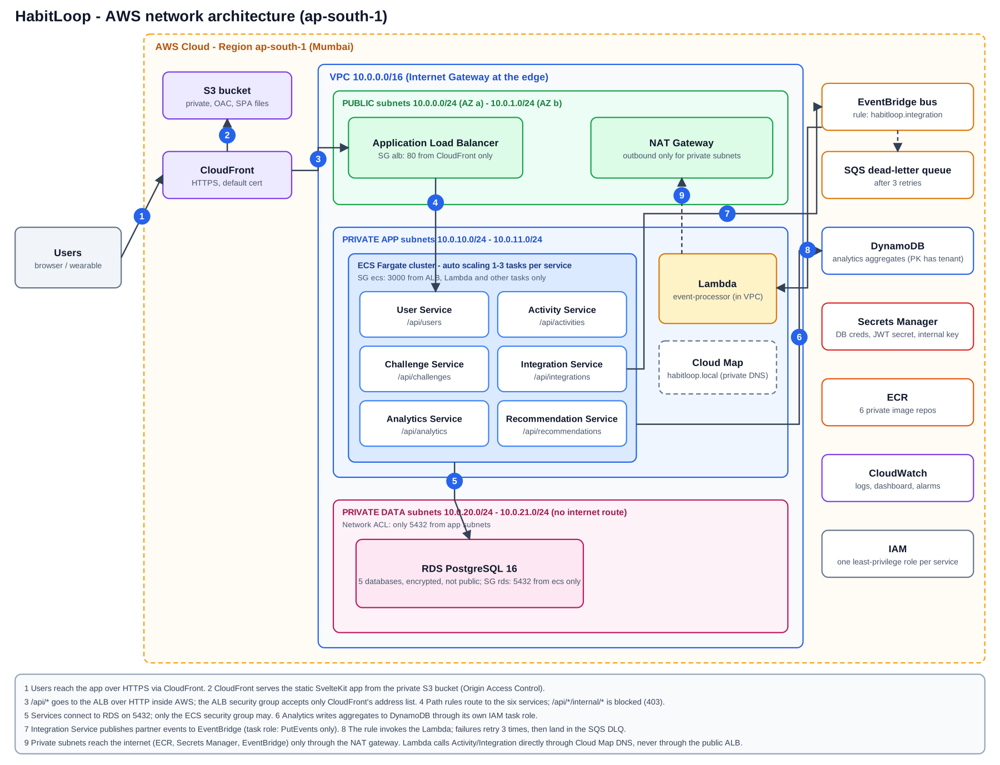

# HabitLoop: AWS deployment documentation

Region: **ap-south-1 (Mumbai)**. Everything is created by Terraform (`infra/terraform`) and deployed with `infra/deploy.sh`.
Live URL during the demo: `https://<distribution>.cloudfront.net` (replace with yours).

The diagram source is [`network-architecture.svg`](network-architecture.svg).

## 1. How it was deployed
1. `aws configure` with an IAM user (never the root user).
2. `./infra/deploy.sh`, which runs five stages:
   1. bundle the Lambda (`npm run bundle`);
   2. create the ECR repositories;
   3. build the six service images and push them to ECR;
   4. `terraform apply` (VPC, RDS, DynamoDB, ECS, ALB, EventBridge, Lambda, CloudFront, CloudWatch);
   5. build the SvelteKit app, sync it to S3 and invalidate CloudFront.
3. Tear-down: `./infra/destroy.sh` (removes everything so nothing keeps billing).

## 2. Services and critical configuration

For every row, add the screenshot named in the last column.

| # | Service | What it does here | Critical configuration to point out | Screenshot |
|---|---|---|---|---|
| 1 | **VPC and subnets** | Network isolation | VPC `10.0.0.0/16`; 2 public (`10.0.0.0/24`, `10.0.1.0/24`), 2 private app (`10.0.10.0/24`, `10.0.11.0/24`), 2 private data (`10.0.20.0/24`, `10.0.21.0/24`) subnets across 2 AZs | `aws-01-vpc-subnets.png` |
| 2 | **Route tables, IGW, NAT** | Controlled routing | Public: `0.0.0.0/0` to the Internet Gateway. App: `0.0.0.0/0` to the NAT gateway. **Data: no default route** | `aws-02-route-tables.png` |
| 3 | **Network ACL** | Stateless data-tier filter | Data subnets accept only TCP 5432 from the app subnets, replies on 1024-65535 | `aws-03-nacl.png` |
| 4 | **Security groups** | Chained, stateful rules | `alb`: 80 from the CloudFront prefix list only. `ecs`: 3000 from `alb`, `lambda` and itself. `rds`: 5432 from `ecs` only | `aws-04-security-groups.png` |
| 5 | **ECR** | Private image registry | 6 repositories `habitloop/<service>-service`, scan on push, keep last 5 images | `aws-05-ecr.png` |
| 6 | **ECS cluster** | Container orchestration | Fargate, 6 services, Container Insights on, circuit breaker with rollback | `aws-06-ecs-services.png` |
| 7 | **ECS task definition** | Config separate from code | 256 CPU / 512 MB; plain settings as environment variables; `JWT_SECRET`, `INTERNAL_API_KEY`, `DB_USER`, `DB_PASSWORD` injected from Secrets Manager (`valueFrom`) | `aws-07-task-definition.png` |
| 8 | **ECS auto scaling** | Handles load | Target tracking on average CPU 60%, min 1, max 3 tasks per service | `aws-08-autoscaling.png` |
| 9 | **Load balancer** | Public entry for the API | Internet-facing ALB in the public subnets; path rules `/api/users*`, `/api/activities*` and so on; priority-1 rule returns **403 for `/api/*/internal/*`**; health check `/health` | `aws-09-alb-rules.png`, `aws-10-target-groups.png` |
| 10 | **RDS PostgreSQL 16** | Transactional data | `db.t3.micro`, encrypted, **Publicly accessible = No**, private data subnets, one database per service | `aws-11-rds.png` |
| 11 | **DynamoDB** | Analytics aggregates | Table `habitloop-analytics`, on-demand, `pk`/`sk`, TTL on `ttl`, point-in-time recovery | `aws-12-dynamodb.png` |
| 12 | **EventBridge** | Event-driven ingestion | Custom bus `habitloop-bus`, rule on source `habitloop.integration`, target = Lambda, 3 retries, DLQ | `aws-13-eventbridge.png` |
| 13 | **Lambda** | Validate, enrich, normalize | Node.js 20, runs in the private app subnets, reads the internal key from Secrets Manager, calls Activity/Integration via Cloud Map DNS | `aws-14-lambda.png` |
| 14 | **SQS dead-letter queue** | Failed events | `habitloop-events-dlq`, 14-day retention, alarm on depth | `aws-15-dlq.png` |
| 15 | **Secrets Manager** | Secrets outside the code | `habitloop/db` (username, password) and `habitloop/app` (JWT secret, internal key), generated by Terraform. **Do not show values** | `aws-16-secrets.png` |
| 16 | **IAM roles** | Least privilege | One task role per service. Analytics: DynamoDB table only. Integration: `events:PutEvents` on the bus only. Others: no AWS permissions. Separate execution role and Lambda role | `aws-17-iam-roles.png` |
| 17 | **S3** | Frontend hosting | Private bucket, block all public access, only CloudFront (OAC) may read | `aws-18-s3.png` |
| 18 | **CloudFront** | HTTPS and global delivery | Two origins (S3 and ALB); `/api/*` uncached and forwarded to the ALB; default behavior serves the SPA; viewer HTTPS only | `aws-19-cloudfront.png` |
| 19 | **CloudWatch dashboard** | Observability | Dashboard `habitloop-ops`: ALB requests/5xx, latency, ECS CPU and running tasks, Lambda, DLQ depth, auth failures, RDS | `aws-20-dashboard.png` |
| 20 | **CloudWatch alarms** | Alerts | API 5xx, latency over 1 s, DLQ depth, Lambda errors, running tasks below 1 per service, 401 spikes; notifications through SNS email | `aws-21-alarms.png` |
| 21 | **CloudWatch logs** | Central logging | `/ecs/habitloop/<service>` and `/aws/lambda/habitloop-event-processor`, JSON logs, 7-day retention | `aws-22-logs.png` |

## 3. Security summary
- **Isolation by tier:** the internet reaches only CloudFront. The ALB accepts traffic only from CloudFront. Containers and the Lambda live in private subnets. The database has no route to the internet.
- **Multi-tenancy:** `tenantId` in the JWT; every query filters by `tenant_id`; DynamoDB partition keys start with the tenant. Another tenant's ids return 404.
- **Secrets:** generated by Terraform, stored in Secrets Manager, injected at start-up. Nothing sensitive is in images or Git.
- **Encryption:** TLS between users and CloudFront; RDS and S3 encrypted at rest; RDS connections use SSL.
- **Internal endpoints** (`/internal/*`) need an internal key and are blocked at the ALB.

## 4. Event flow on AWS (what to demonstrate)
1. A device posts to `/api/integrations/events` with its device token (stored hashed in RDS).
2. The Integration Service writes the event to RDS as `RECEIVED` and calls `PutEvents` on the bus.
3. EventBridge triggers the Lambda, which validates the schema and timestamp, enriches the event and writes an activity log through the Activity Service.
4. The event becomes `PROCESSED` (or `REJECTED` with a reason, for example "No matching habit for this event").
5. The Activity Service notifies Analytics, which updates DynamoDB; the dashboard shows the change within 5 seconds.
6. Replaying the same event id is ignored (idempotent in RDS, in the Activity Service and in DynamoDB).

## 5. Trade-offs and known limitations
- **No custom domain:** users get HTTPS from CloudFront. CloudFront to ALB is HTTP inside AWS. With a domain, an ACM certificate on the ALB would give end-to-end TLS.
- **One NAT gateway** to save cost (one per AZ would remove the single point of failure).
- **Shared RDS administrator user** across the services; per-service database users would be tighter.
- **Stronger separation makes debugging harder:** that is why logs, the dashboard and alarms are part of the design.

## 6. Cost and clean-up
Running the full stack costs roughly 5-6 USD per day (NAT gateway, ALB, RDS, six Fargate tasks). It was deployed for the demo and destroyed afterwards with `./infra/destroy.sh`.
